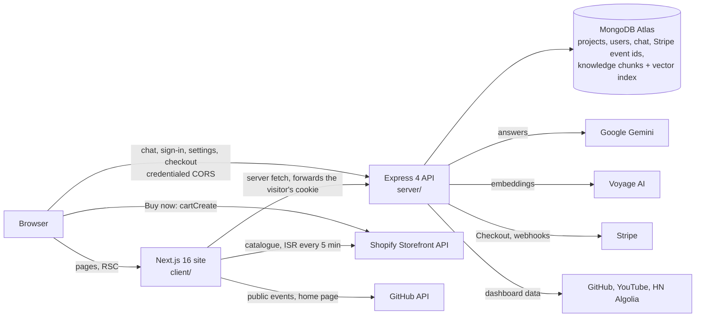

# Rebuild Phase 2: audit of the existing project

- **Date:** 2026-11-22
- **Branch:** `rebuild/phase-2-audit` (from `rebuild/phase-1-environment`)
- **Audited:** `main` at `d09ea37`, every source file in `server/` and `client/`, the e2e and QA suites, CI, the README, `client/DESIGN-SYSTEM.md` and `docs/release-report.md`
- **Code changed:** none

## How this was done

- Read every server source file and every client route, library and component that touches data, sessions, integrations or SEO. UI components were read where they drive behaviour, and judged visually from full-page screenshots at 375, 768 and 1440 px.
- Ran all CI checks on Node 24 (Phase 1 baseline: all pass), `npm audit --omit=dev`, and checked the installed and latest versions on the npm registry.
- Started the production build against the e2e mock API and measured each public route on a Pixel 7 profile: bytes per resource type, console errors, page metadata, `robots.txt` and the sitemap.
- Checked claims against official sources, fetched on 2026-11-22: the Shopify Storefront API reference, Stripe's API-version guide, the installed stripe-node source, the Voyage AI model list, the Express 5 migration guide, the Atlas Vector Search reference, and the Next.js metadata reference shipped in `client/node_modules/next/dist/docs/`.

## 1. Summary

**The architecture is sound: keep it.** A Next.js site and a separate Express API over MongoDB, each deployed on its own, is a reasonable shape for this product, and the code inside it is careful. Modules are split by feature, pure logic is unit-tested apart from I/O, input is validated at every API boundary, and failures degrade instead of crashing. Nothing found justifies a rewrite.

The dissatisfaction is explained by four other things.

1. **Scope.** Most of the code is three demonstration products: a subscription SaaS, a Shopify store, and an AI assistant with a project planner. They are well built, but they are the site's main content. The portfolio itself (who you are, what you have done) is thin, and the site reads as a services landing page.
2. **Identity.** The visual language is adapted from a reference site you chose (`client/DESIGN-SYSTEM.md`, "Concept") and leans on widely used portfolio devices. The favicon is still the create-next-app Vercel triangle.
3. **Concrete fixes.** Two critical and three high dependency advisories, authentication hardening that was deferred, uncached third-party calls, and a few correctness bugs. All are localized.
4. **Never proven in production.** Nothing has been deployed. No automated test runs the real API against a database, and Stripe Checkout has never run end to end.

## 2. Architecture map

| Area | Routes (site) | API |
| --- | --- | --- |
| Portfolio | `/`, `/projects`, `/projects/[slug]` | `GET /api/projects`, `GET /api/projects/:slug` |
| Assistant and planner | panel on every public page | `POST /api/ai-chat/chat` (SSE), `GET /api/ai-chat/chat/:id`, `POST /api/ai-chat/discovery` (SSE) |
| Creator Dashboard | `/saas`, `/saas/signup`, `/saas/login`, `/saas/dashboard`, `/saas/dashboard/settings` | `/api/saas/auth/*`, `/api/saas/billing/checkout`, `/api/saas/billing/webhook`, `/api/saas/aggregator`, `/api/saas/settings` |
| Shop | `/shop`, `/shop/[handle]` | none (Shopify directly) |
| CMS admin | `/login`, `/dashboard`, `/dashboard/projects/*` | `/api/admin/auth/*`, `/api/admin/projects/*` |
| Platform | `sitemap.xml`, `robots.txt`, `opengraph-image`, `llms.txt` | `/health`, `/api/health` |

## 3. Feature inventory (input for your scope decision)

| Feature | What it does | Code (lines) | Needs to run | Risk and upkeep it carries |
| --- | --- | --- | --- | --- |
| Portfolio pages | Home, work list, case studies | ~2,450 with shared UI | API and MongoDB for case studies | Low |
| CMS admin | You draft and publish case studies | ~900 | MongoDB, admin credentials | Low: one admin account |
| AI assistant chat | Answers questions about you from a knowledge base, with sources | ~2,300 | Gemini key, Voyage key, Atlas vector index | Model and embedding versions drift; cost exposure; stores visitor messages for 30 days |
| Project planner | Multiple-choice questionnaire; AI writes a project brief | ~1,350 | Gemini key | The brief goes nowhere: the visitor keeps it (PR #19 adds sending it) |
| Creator Dashboard | Sign-up, Stripe subscription, GitHub, YouTube and Hacker News numbers | ~4,400 (the largest) | Stripe account and webhook, GitHub token, YouTube key, MongoDB | Highest: real accounts and passwords, billing, provider quotas; no cancellation, password reset or account deletion |
| Shop | Server-rendered Shopify catalogue, Buy now to Shopify checkout | ~700 | A Shopify store and Storefront token | Low; deprecated query to replace |

Plus about 2,500 lines of CSS, 2,800 lines of e2e and QA tests, and 1,100 lines of server core.

## 4. Frontend and backend boundaries

**KEEP.** The boundary is drawn correctly.

- Secrets live only in the API. The browser gets `NEXT_PUBLIC_*` values only, and the Shopify token there is Shopify's public Storefront token.
- `server-only` guards the modules that read cookies (`client/src/lib/server-api-client.ts`, `admin-session.ts`, `saas-server.ts`).
- Route guards in the site are a convenience. The API checks the session and role on every protected route (`content.routes.ts:17` blanket admin guard; `requireRole('user')` on every SaaS route) and reads the subscription status from the database on every request (`require-active-subscription.middleware.ts`).
- Client JavaScript is limited to 25 files. The assistant panel loads only on intent, and no Stripe, admin or dashboard code reaches public pages.

Two weaknesses, both REFACTOR candidates:

- **Duplicated contracts.** Request and response types are written twice (`client/src/types/*`, `client/src/lib/admin-client.ts` against `server/src/modules/*/*.types.ts`). Nothing checks they agree; the e2e mock API (`client/e2e/mock-api/server.mjs`) is a third hand-written copy.
- **Optional features are hard requirements.** `client/src/lib/config.ts:34-41` throws without the Shopify variables, and every page imports it, so the whole site fails to build without a Shopify store. That contradicts the README ("Every one is optional").

## 5. Security findings

Ranked by severity. Each cites its evidence.

| # | Severity | Finding | Evidence | Fix |
| --- | --- | --- | --- | --- |
| S1 | **High** | Production dependency advisories. Server: `mongoose` 8.24.1 (critical), `proxy-addr` 2.0.7 (critical), `body-parser` 1.20.6, `ip-address` 10.2.0 via `express-rate-limit`, `zod` 3.25.76 (high), `qs` (moderate). Client: `nanoid`, `source-map-js` in Tailwind's PostCSS build tooling (high, build-time only). | `npm audit --omit=dev` (Phase 1 record) | All but Zod are fixed inside the current majors: mongoose 8.24.10, and lockfile updates within the ranges express 4.22.3 and express-rate-limit already accept (body-parser 1.20.9, proxy-addr 2.0.8, qs 6.16.2, ip-address 10.7.6). Zod needs 3 to 4. Practical exploitability here is low (no `sanitizeFilter` or discriminators; proxy spoofing needs a subnet in `TRUST_PROXY`), but the fixes are cheap. |
| S2 | Medium | `JWT_SECRET` is optional at start-up. Without it the API starts, then every sign-in fails with a 500 whose message names the missing variable. | `server/src/core/config/env.ts:64`, `core/middleware/auth.ts:32-37` | Require it at start-up (as `ADMIN_EMAIL` already is). |
| S3 | Medium | Sessions cannot be revoked. Tokens live 7 days; logout only clears the cookie, so a copied token keeps working. | `auth.ts:39-41`, `admin-auth.controller.ts:55-65`, `saas-auth.controller.ts:70-73` | A token version per account (and one for the admin) checked on each request; bump it on logout. Listed as deferred in the release report. |
| S4 | Medium | Admin and SaaS tokens share one secret and format, with no audience or issuer, and verification does not pin the algorithm. Separation rests on the `role` claim and cookie names. | `auth.ts:40`, `auth.ts:45` | Pin `algorithms: ['HS256']`; give each context its own audience and verify it per route. |
| S5 | Medium | Account enumeration: sign-up answers 409 for a taken email, and both logins skip bcrypt for an unknown email, so timing differs. | `saas-auth.controller.ts:30`, `errorHandler.ts:77-89`, `saas-auth.controller.ts:51-52`, `admin-auth.controller.ts:34-37` | Same response for taken and new emails; always run one bcrypt comparison. |
| S6 | Medium | AI cost exposure: chat and planner are limited per IP only (20 per 10 minutes in production), with no overall daily budget. Requests from many addresses can exhaust the Gemini and Voyage quota or bill. | `core/middleware/rateLimiter.ts:78-88` | A global daily cap (count in MongoDB) and alerting. |
| S7 | Medium | Account lifecycle gaps in the paid product: subscribers cannot cancel or manage billing (no Stripe customer portal), and there is no password reset or account deletion. Chat transcripts (30 days) and account emails are stored with no privacy notice. | `billing.routes.ts`, `saas-auth.routes.ts`, `ai-chat.model.ts:38-41`; no privacy route in `client/src/app` | Depends on scope (section 12). If the SaaS stays and takes real payments, these are required; check the consumer rules for your markets. |
| S8 | Low | Input limits: settings fields and CMS text fields have no maximum length; CMS `liveUrl`/`repoUrl` accept any URL scheme, including `javascript:`. React 19 blocks `javascript:` links and the CSP backs it up, so this is defence in depth. | `settings.update.ts:15`, `content.controller.ts:9-18`, `components/work/ProjectShowcase.tsx:33-34` | Length caps; http(s) only. |
| S9 | Low | Small information leaks: `/health` reports `NODE_ENV`; misconfiguration errors name variables to the visitor. | `core/app.ts:55-63`, `stripe.service.ts:47`, `youtube.service.ts:88` | Generic messages; log the detail. |
| S10 | Low | Rate-limit counters and the fallback chat history are per process. Correct for one instance; they reset on restart and split across instances. | `rateLimiter.ts`, `ai-chat/session-store.ts` | Shared store (MongoDB) only if you run more than one instance. |
| S11 | Info | The site's CSP allows `'unsafe-inline'` scripts so pages can stay static (documented trade-off). | `client/src/lib/security-headers.ts` | Keep while pages are static. |

**KEEP (already correct):** exact-match credentialed CORS (`core/config/origins.ts`); `TRUST_PROXY=true` refused (`trust-proxy.ts`); httpOnly, `SameSite=Strict`, `Secure` cookies with matching set and clear attributes (`session-cookie.ts`); Zod at every API boundary; sanitized errors (`errorHandler.ts`); Stripe signature verification on the raw body, once-only event processing and newest-event-wins ordering in one atomic write (`stripe-events.ts`, `webhook.controller.ts`); entitlement read from the database on every request; security headers on the API and the site; JSON-LD escaped (`components/site/JsonLd.tsx`); no raw HTML rendered anywhere else; retrieval reads public data only, so the assistant has no tenant-isolation risk; prompt-injection rules in both system prompts.

## 6. Integration reliability

| Integration | Verdict | Findings |
| --- | --- | --- |
| MongoDB | KEEP | Starts without the database, retries with backoff, answers 503 with `Retry-After` while it is down (`core/config/db.ts`, `http-hygiene.ts:58-67`). |
| Stripe | KEEP, FIX | The comment says no API version is pinned so the account default applies (`stripe.service.ts:15-18`). That is wrong: the installed stripe-node sends its own pinned version, `2026-07-29.dahlia` (`node_modules/stripe/esm/stripe.core.js:166`), while webhook events arrive in the endpoint's version. Pin `apiVersion` explicitly and create the endpoint at the same version. Customer creation has no idempotency key, so two simultaneous checkouts can create two customers (`billing.controller.ts:26`). Never run end to end in test mode. |
| Gemini | KEEP, FIX | Resilient: first-chunk and total timeouts, model fallback, background health checks (`llm.service.ts`, `model-health.ts`). Uses floating `-latest` aliases (`model-health.ts:20`), so behaviour can change without a code change. Current model names were not verified: Google's model docs moved to aistudio.google.com, which this environment does not allow yet. |
| Voyage AI | FIX | `voyage-3-lite` (512 dimensions, `embedding.service.ts:7`) is still listed but is two generations old; the current lite model is `voyage-4-lite` (1024 by default, 512 available). Moving keeps the index size but needs a re-seed. |
| Atlas Vector Search | KEEP, FIX | Index created at start-up; `numCandidates` set at 15 times the limit, as the reference requires for approximate search. **Doc bug:** the README says to seed and index the `knowledgechunks` collection (`README.md:65`, `README.md:158`); the model uses `knowledge_chunks` (`ai-chat.model.ts:78`). An index built by following the README would never be used. |
| Shopify | KEEP, FIX | `productByHandle` is deprecated ("Deprecated. Use `product` instead.", Storefront API reference); used at `client/src/lib/shopify-products.ts:104`. Pinned to 2026-07 (supported; 2026-10 is the current stable). `@shopify/storefront-api-client` 1.0.x, latest 2.0.1. |
| GitHub, YouTube, Hacker News | FIX | Each source fails on its own with an 8 s timeout, which is good. **No caching:** every dashboard load makes about 14 provider calls (GitHub 2, YouTube up to 3, Hacker News 9). Without a token GitHub allows 60 an hour for the whole server. |
| Site to API | FIX | No timeout on any site-to-API call (`client/src/lib/server-api-client.ts:33`, `api-client.ts:47`, `github-activity.ts:60`), so a hung API stalls server-rendered pages. |
| Logging | FIX | 38 `console.*` calls next to 6 structured `log.*` calls; production logs are only half JSON. |

## 7. Performance and SEO

Measured on 2026-11-22: the production build against the e2e mock API, Pixel 7 profile, gzip sizes.

| Route | HTML | JavaScript | CSS | Fonts | Console errors |
| --- | --- | --- | --- | --- | --- |
| `/` | 32.5 KB | 140.2 KB (10 files) | 16.9 KB | 36.2 KB | 0 |
| `/projects`, a case study | 12-13 KB | 140.2 KB | 16.9 KB | 36.2 KB | 0 |
| `/saas`, `/saas/login` | 5-20 KB | 151.2 KB (14) | 16.9 KB | 36.2 KB | 0 |
| `/shop`, a product | 7-8 KB | 157.1 KB (13) | 16.9 KB | 36.2 KB | 0 |

- **Performance: KEEP.** The JavaScript is mostly the React and Next.js runtime; the extra on shop and SaaS pages is their own interactivity. Fonts are self-hosted subsets. The release report's Lighthouse results (mobile 94 to 100, desktop 100, CLS at or near 0) are lab numbers from a laptop; I did not re-run them, and there is no field data because the site was never deployed.
- The one stylesheet (93 KB raw) carries the dashboard and hero-orbit styles to every page. Minor at 17 KB gzip.
- The home hero is a 300vh pinned scroll scene, 46% of the home page's scroll length, spent on a decorative orbit. That is a UX cost before it is a performance one (section 8).
- **SEO defect:** the four main pages (`/`, `/projects`, `/saas`, `/shop`) have no `og:image`, `twitter:image`, `og:type`, `og:site_name` or `og:locale`, yet declare `summary_large_image` cards. Each page sets its own `openGraph` (`(public)/page.tsx:19`, `projects/page.tsx:11`, `saas/page.tsx:13`, `shop/page.tsx:19`), and Next.js merges metadata shallowly, so it replaces the root layout's object, image included (Next.js `generate-metadata` reference, "Merging"). Shared links to these pages show no preview image.
- **KEEP:** unique titles and descriptions, canonical URLs, one `h1` per page, real 404s with `noindex`, `robots.txt` disallowing the dashboards, a sitemap with projects and products, Person and WebSite JSON-LD, `llms.txt`.
- The favicon is create-next-app's default (`client/src/app/favicon.ico`, the Vercel triangle; MD5 `c30c7d42…`), and there is no `apple-icon`.

## 8. UI and UX

What works, and should survive any redesign:

- A written design system with reasons (`client/DESIGN-SYSTEM.md`), one token source (`globals.css`), a type scale, and contrast ratios computed for every token pair.
- Accessibility checked by axe on nine pages in both profiles with no serious issues, a focus-trapped assistant dialog, reduced-motion fallbacks for every animation, and no horizontal scroll at 375, 768 or 1440 px.
- Animation limited to `transform` and `opacity`, and no layout shift.

Why it reads as generic:

- **Borrowed identity.** "The tight grotesk headlines and the mono micro-labels follow the reference the owner chose (an Awwwards product site with a pinned, scroll-driven hero)", and the palette comes "from the owner's reference" (`DESIGN-SYSTEM.md`, Concept and Color). The site wears someone else's look.
- **Familiar devices:**
  - a pinned hero with a 3D orbit of tech-stack cards carrying brand logos;
  - an X/Y cursor-coordinate readout and "Structures / Software" side labels;
  - word-by-word scroll reveals;
  - registration crosses and blueprint drawings;
  - mono uppercase text on every button;
  - a fixed frame around the viewport;
  - a sample-data dashboard on marketing pages;
  - a closing call-to-action band ("Tell me what you're building.").
- **Template slogans:** "Your product, built to hold up.", "One engineer. The whole stack.", "Try before you hire."
- **The page is about the offer, not the person.** The first screen sells a service. The proof is three demos built for the site, the About section is mostly two certificates, and the engineering judgement that makes the code good (visible all through this audit) is invisible to a visitor.
- **The main call to action dead-ends.** "Plan your project" produces a brief the visitor keeps; the only contact is LinkedIn. There is no form or email.
- **Leftovers:** the default favicon; five unused create-next-app SVGs in `client/public/`.
- The visual system is large for the site's size: 2,505 lines of CSS, 136 custom properties and 24 keyframe sets, much of it decorative motion.

## 9. Technical debt, ranked

| Rank | Item | Evidence | Class |
| --- | --- | --- | --- |
| 1 | Dependency advisories | S1 | FIX |
| 2 | Never deployed. No automated test against a real database in CI (the QA suite in `client/e2e/qa` needs a local MongoDB on port 27018 and provider keys, and runs by hand). Stripe never run end to end; Docker image never built. | release report, "Not verified"; `client/e2e/qa/settings.ts:31` | FIX |
| 3 | Authentication hardening | S2 to S5 | FIX |
| 4 | Dashboard provider calls uncached; no site-to-API timeouts | section 6 | FIX |
| 5 | Correctness: README collection name, Stripe version comment and pinning, deprecated Shopify query, missing OG tags | sections 6 and 7 | FIX |
| 6 | Major versions behind: express 4 to 5.3, mongoose 8 to 9, zod 3 to 4, stripe 22 to 23, @google/genai 2 to 3, @shopify/storefront-api-client 1 to 2, typescript 5 to 7, eslint 9 to 10, dotenv 16 to 18; Node 24 while 26 is the active LTS | npm registry, 2026-11-22 | FIX, one at a time, each against its migration guide |
| 7 | Contracts written three times (client types, server types, mock API) | section 4 | REFACTOR |
| 8 | Optional features required by the site's config | `client/src/lib/config.ts:34-41` | REFACTOR |
| 9 | Dead code and assets: 14 empty server files (`src/index.ts`, `modules/admin-cms/*`, `api-aggregator/*`, `storefront/*`, `ai-chat/vectorStore.ts`), unused `describeTrustProxy`, a commented-out route mount, five unused SVGs | `grep` finds no references | FIX |
| 10 | Mixed logging | section 6 | FIX |
| 11 | CI has no dependency audit or automated update PRs; no npm install-script policy (npm 11 warns about `unrs-resolver`) | `.github/workflows/ci.yml` | FIX |
| 12 | `.continue/rules/portfolio-conventions.md` tells another assistant that `cors()` runs open globally; the API uses an origin allowlist, and the Stripe webhook needs its raw body before `express.json()` | `core/app.ts:32-46` | FIX or remove (your call) |
| 13 | Two open PRs (#19 send the brief, #12 editorial showcase) and 16 stale remote branches | GitHub | Decision |

## 10. KEEP, FIX, REFACTOR, REDESIGN by area

| Area | Decision | Why |
| --- | --- | --- |
| Overall architecture (Next.js site, Express API, MongoDB, deployed separately) | **KEEP** | Clear boundaries, correct trust model, tested; no defect that a different architecture would remove |
| Server module layout and the pure-helper testing pattern | **KEEP** | Easy to follow, already tested |
| Authentication and sessions | **FIX** | S2 to S5; the design is right, the hardening is missing |
| Stripe billing and webhook | **KEEP + FIX** | Core logic is correct; pin the version, add an idempotency key, prove it end to end |
| RAG assistant | **KEEP + FIX** | Robust; pin models, fix the README, cap cost |
| Dashboard data sources | **FIX** | Caching and input limits |
| Site data layer | **FIX + REFACTOR** | Timeouts; one source for API contracts |
| Feature configuration | **REFACTOR** | Each feature's settings optional, with the feature switching itself off |
| SEO plumbing | **KEEP + FIX** | Sound; restore the shared Open Graph fields |
| Design method (tokens, accessibility rules, motion rules) | **KEEP** | Good discipline to carry into the new identity |
| Visual identity, home page and content | **REDESIGN** | Borrowed look, template devices, offer-first content; needs your direction (Phase 5) |
| Tests | **KEEP + extend** | Good unit and e2e coverage; add database-backed integration tests to CI |
| Dependencies | **FIX** | Advisories now; majors deliberately in Phase 4 |
| Deployment | **Missing** | Hosting, domain, monitoring to be decided |

## 11. Recommended target architecture (preliminary)

The same shape, made trustworthy:

- **Site:** Next.js, server-rendered and static where possible. Each optional feature reads its own configuration and turns itself off when it is missing.
- **API:** Express, upgraded to 5 when the migration is done (async errors handled natively, so `asyncHandler` goes). Hardened auth: required secret, pinned algorithm, a separate audience per context, revocable sessions.
- **Data:** MongoDB Atlas; the vector index only if the assistant stays.
- **Contracts:** one definition of each request and response, used by the API, the site and the mock API. How (shared folder, npm workspaces, or generated types) is a Phase 3 decision with its trade-offs.
- **Verification:** CI adds a MongoDB service for API integration tests and a dependency audit; Stripe is proven once end to end in test mode before launch.

How much of this applies depends on scope. Without the Creator Dashboard, for example, there are no customer accounts, passwords or billing: the only login is yours, and roughly a third of the code and the largest security surface go away. That is why the scope decision comes first.

## 12. Decisions needed from you before Phase 3

1. **Scope.** Which features stay: portfolio pages, CMS admin, assistant chat, project planner, Creator Dashboard, shop? Section 3 lists what each costs. Nothing will be removed without your decision.
2. **Audience and purpose.** Who is the site for: freelance clients, employers, or both? The knowledge base says you are open to freelance, contract and full-time roles, but the site speaks only to clients.
3. **Contact path.** Where should an enquiry or a project brief go: email, a form that emails you, or something else? PR #19 starts on this.
4. **Open PRs.** #19 (send the brief) and #12 (editorial showcase): merge, fold into the rebuild, or close.
5. **Hosting.** Where the site and API will run, and the domain. The README assumes Vercel for the site and any Node host for the API.
6. **Continue rules.** Do you still use the Continue assistant? If not, `.continue/` can go; if so, its CORS rule needs correcting.
7. **Visual direction (for Phase 5, no need to answer now).** What you want the site to say about you, and sites you like or dislike. Phase 5 will not start from a reference to imitate.

## 13. Not verified

- The API against a real database, sign-up, login, the CMS and the webhook store. They are covered by unit tests and the mock API only. Neither Docker nor MongoDB is available in this environment; GitHub CI can run a MongoDB service.
- Live providers (Gemini, Voyage, Stripe test mode, Shopify, GitHub, YouTube): no keys in this environment, by design.
- Current Gemini model names: Google's docs moved to aistudio.google.com, which is not on this environment's allowlist yet.
- Deployment, the Docker image, graceful shutdown on a real host, `COOKIE_DOMAIN` across two hosts.
- Browsers other than Chromium; field performance.
