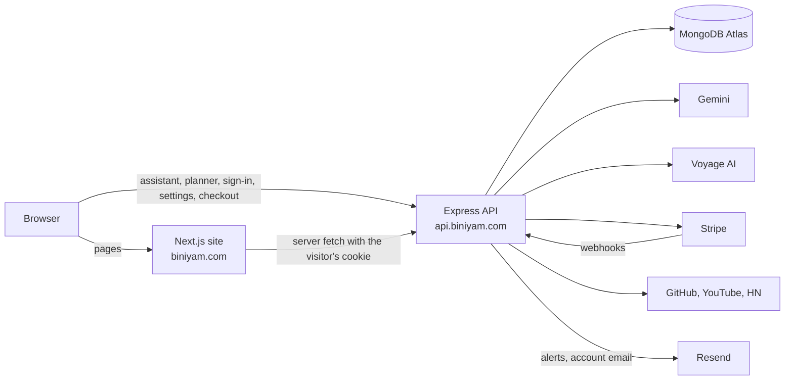

# Rebuild Phase 3: architecture and implementation plan

- **Date:** 2026-11-23
- **Branch:** `rebuild/phase-3-plan`
- **Inputs:** `docs/rebuild/phase-2-audit.md` and the user's answers there; checks run for this plan (below)
- **Status:** approved by the user on 2026-11-23 (hosting: economical options, section 3). Phase 4 runs on `rebuild/phase-4-mvp`.

## 1. Scope

| Keep | Remove | Add |
| --- | --- | --- |
| Portfolio pages, CMS admin, assistant chat, project planner, Creator Dashboard | The shop (pages, Shopify client, tests, knowledge-base note calling it live) | Enquiries from the planner (PR #19) with an email alert; the account lifecycle a paid product needs (section 4.4) |

Audience: freelance clients. Domain: biniyam.com. PR #12 closed; PR #19 folded into the rebuild.

## 2. What was verified for this plan

| Check | Result |
| --- | --- |
| All server majors applied together in a scratch copy (Express 5.3, Mongoose 9.12, Zod 4.6, Stripe 23.2, @google/genai 3.6) | Type-check clean, 54/54 unit tests pass, `npm audit` 0 vulnerabilities |
| The upgraded server against a real MongoDB (in-memory 8.2.6) | 19/19 core flows pass: sign-up, login, sessions, admin/SaaS separation, subscription gate, settings, CMS draft and publish, 404s, chat history |
| The same run found two upgrade breaks a type-check cannot see | Stripe 23 throws at start-up without a key (`stripe.service.ts:18`), so billing would stop being optional; Mongoose 9 warns on `{ new: true }` |
| TypeScript 6.0.3 on both packages | Clean |
| TypeScript 7 | Blocked: typescript-eslint supports `<6.1.0` |
| ESLint 10 | Blocked for the site: `eslint-config-next` uses React, import and jsx-a11y plugins that accept ESLint `^9` at most |
| Stripe API version `2026-11-18.endive` (Stripe 23's pin) | Its breaking changes (no `payment_method_types` on Checkout, and others) do not touch this integration |
| In-memory MongoDB for tests | Runs here (binary host now allowed), on Windows and on GitHub's runners |
| Gemini | Google: "Most production apps should use a specific stable model"; `-latest` aliases are hot-swapped with two weeks' notice |

## 3. Target architecture

The audited shape stays. Changes are inside it.

| Decision | Choice | Why, and the trade-off |
| --- | --- | --- |
| Packages | Keep `client/` and `server/` independent | A shared contracts package would need a workspace root, which Next.js and the hosts handle awkwardly. Instead, database-backed API tests pin the response shapes. Revisit if the API grows. |
| Sessions | Keep httpOnly, `SameSite=Strict` cookies with `COOKIE_DOMAIN=biniyam.com` | Proven design. Hardened in 4.3. |
| Environments | One deployment on biniyam.com, in Stripe test mode and closed to search engines until launch | A `staging.` subdomain would receive production session cookies (they are set for all of biniyam.com). A second domain costs money for little gain before launch. |
| Email | Resend over its HTTP API with `fetch`, no SDK | Free tier: 3,000 emails a month, 100 a day, SPF/DKIM/DMARC on your domain. Postmark's free tier is 100 a month. |
| AI models | Pin two stable Gemini models | Candidates: `gemini-4-hydrogen` ($1.50/$7.50 per million tokens in/out, about $0.008 per chat turn) and `gemini-3.5-flash-lite` ($0.30/$2.50, about $0.002). Both have a free tier. Primary and fallback are chosen by measuring both on the knowledge-base questions with your key. |
| Embeddings | Move to `voyage-4-lite` at 512 dimensions | Current generation; same index size. The knowledge base is re-seeded at deployment anyway. |
| Test database | `mongodb-memory-server` (dev dependency) | One command everywhere (`npm test`); no Docker or local install. |
| Runtime | Stay on Node 24 | Maintained LTS; move to 26 once both hosts support it. |
| `dotenv` | Remove; use Node's built-in `--env-file-if-exists` | One dependency fewer (it is a major behind anyway). |
| Dependency watch | CI fails on high advisories; enable GitHub's Dependabot **alerts** | Dependabot update pull requests would add a bot as a commit author, and you are the only contributor. |

### Hosting (your choice, section 6)

The user asked for free or very economical hosting. Checked on 2026-11-23 against each provider's own pages:

| | 1: Railway (site and API) | 2: Cloudflare Workers (site) + Koyeb free (API) | 3: Netlify free (site) + Koyeb free (API) |
| --- | --- | --- | --- |
| Monthly | **about $5**: the $5 Hobby fee includes $5 of usage (memory about $10 per GB-month, CPU about $20 per vCPU-month); two small always-on services should fit, and a usage limit stops surprises | **$5**: Workers Free allows only 10 ms of CPU per request, too little for server-rendered pages, so the $5 Paid plan; Koyeb's one free instance for the API | **$0** |
| Always on | Yes | Site yes; the API sleeps after 1 hour idle and wakes in 1 to 5 s | Site within its credits; API as option 2 |
| Speed for visitors worldwide | One region | Site served from Cloudflare's global network | Netlify's network |
| Risks | Usage above $5 is billed (set the limit) | More setup (Cloudflare's Next.js adapter, checked for Next 16); first assistant or dashboard request after an idle hour waits | 300 credits a month, 15 per deploy; when they run out, **every** project pauses until next month |
| Recommendation | **Recommended**: cheapest option with nothing that sleeps or pauses, and the least setup | Best speed for the money, at more setup | Only if $0 is a must |

Commercial use is allowed on all three (a freelance site with a paid product is commercial; Vercel's free plan is not, and its Pro plan is $20 a month).

Database: Atlas Free ($0; 0.5 GB, no backups). Stripe remains the record of who pays and each enquiry is also emailed to you, so a data loss would cost accounts and chat history but not billing state or enquiries. Atlas Flex ($0.011 an hour, at most $30 a month, daily snapshots) once paying customers make backups worth it. Email (Resend), Gemini and Voyage start on free tiers.

## 4. Phase 4 plan, in order

Each step ends with lint, type-check, unit, database-backed and e2e tests where they apply, and is committed and pushed in small commits. The order puts the test foundation and the upgrades first, so new code is written once against the final APIs.

### 4.1 Foundation
1. Merge PR #19 (enquiries) into the rebuild branch; run every check.
2. Patch advisories inside the current majors (`npm audit fix`; client PostCSS tooling).
3. Remove the shop: routes, components, Shopify client and types, CSP and image settings, sitemap entries, e2e fixtures and tests, nav and footer links, the knowledge-base note, docs. The site config stops requiring Shopify values.
4. Remove dead code and assets: 14 empty server files, `describeTrustProxy`, the commented route, five create-next-app SVGs.
5. Fix the README's collection name (`knowledge_chunks`).

### 4.2 Tests and upgrades
1. Database-backed API tests: the 19 flows above become the suite, then grow with each step. CI runs them with a cached MongoDB binary and adds `npm audit --omit=dev --audit-level=high`.
2. Upgrade one major at a time, each followed by the full suite: Express 5 (drop `asyncHandler`), Mongoose 9 (`returnDocument: 'after'`), Zod 4 (readable messages), Stripe 23 (client created only when configured, API version pinned to `2026-11-18.endive`), @google/genai 3 (client created only when configured), TypeScript 6.0, `dotenv` removed. ESLint stays on 9 and TypeScript below 7 until their blockers clear.

### 4.3 Authentication hardening
1. `JWT_SECRET` required at start-up; verification pinned to HS256.
2. Separate audiences for admin and customer tokens, checked per route.
3. Revocable sessions: a token version per account (and for the admin) checked on each request; logout and password changes bump it.
4. No account enumeration: one bcrypt comparison whatever the email; sign-up answers the same for new and taken addresses (made possible by email verification, 4.4).

### 4.4 Email and the account lifecycle
1. Resend client (alerts and account email); sending domain set up on biniyam.com.
2. New-enquiry email to you, with the brief, so you can reply directly.
3. Email verification on sign-up; checkout requires a verified address.
4. Password reset: single-use, hashed, 30-minute links.
5. Stripe customer portal: subscribers update their card or cancel themselves.
6. Account deletion: cancels the subscription at Stripe and deletes the account's data.
7. A privacy page stating exactly what is collected (accounts, chat messages for 30 days, enquiries for 12 months, Stripe) and terms for the subscription, drafted for your review.

### 4.5 Integrations and limits
1. Stripe: idempotency key on customer creation; webhook endpoint created at the pinned API version.
2. Gemini: pinned models (measured with your key), a global daily cost cap stored in MongoDB, and an alert when it trips.
3. Voyage: `voyage-4-lite` at 512 dimensions, re-seed.
4. Dashboard sources: 10-minute cache per account identifier; length limits on settings.
5. Site to API: timeouts on every server fetch.
6. Input limits on CMS fields; http(s)-only project links.
7. Generic messages for configuration errors; `NODE_ENV` out of `/health`; one structured logger.
8. Open Graph: shared base so every page has its image and site fields.

### 4.6 Deployment and end-to-end proof
1. Create the hosting services, DNS records, Atlas project, Resend domain and Stripe test webhook. Secrets go into each host's settings, never into git or chat.
2. Deploy from `main` (you approve the pull request that brings the rebuild in), with search engines blocked.
3. Verify on biniyam.com, in a real browser:
   - Stripe test checkout unlocks the dashboard through the webhook; the portal cancels it.
   - An enquiry arrives in the admin and by email.
   - Sign-up verification, password reset and account deletion work.
   - The assistant answers from the seeded knowledge base with the pinned models.
   - Health checks, logs and the cost cap behave as designed.
4. Run `security-review` and `code-review` over the Phase 4 changes; fix what they find.
5. Record results in `docs/rebuild/phase-4-mvp.md`. Phase 5 (UI/UX) starts from there; launch (live Stripe, search engines allowed, Search Console) is its last step.

## 5. Phase 4 is done when

- Every kept feature works end to end on biniyam.com with real providers in test mode, proven by the checks in 4.6.
- `npm audit --omit=dev` reports nothing high in either package.
- CI runs lint, types, unit, database-backed and e2e tests on every pull request, and they pass.
- The Phase 2 findings S1 to S10 are fixed or consciously accepted in the Phase 4 record.

## 6. What I need from you

1. ~~Approve this plan~~ approved 2026-11-23.
2. **Hosting:** option 1, 2 or 3 above (needed by step 4.6).
3. ~~biniyam.com~~ owned by the user; where its DNS is managed is needed by step 4.4.
4. **Later, at step 4.4 and 4.6 (not now):** accounts for the chosen host, Resend and Atlas, and keys for Gemini, Voyage, Stripe (test), GitHub and YouTube. You add them in each service's settings; I will say exactly which, when.
